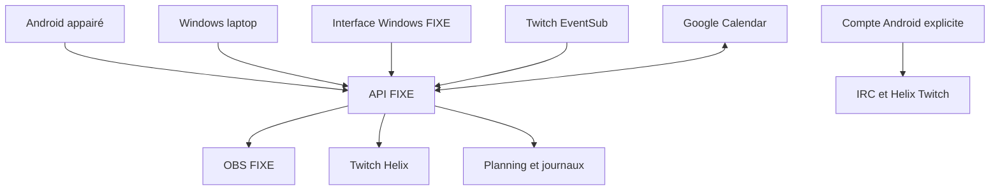

# Dépendances vérifiées dans les sources

Les arêtes correspondent à SERVICE_FLOW_DETAILS.json. Android local est un choix explicite indépendant ; les effets de régie restent sur FIXE.

Autres intégrations FIXE : Streamlabs Socket.IO alimente le feed et les moments ; Discord REST et WizeBot utilisent des actions explicites ; Spotify utilise le lecteur Windows local. Soundboard, mixeur et replay de régie restent des effets FIXE. Aucun diagramme ne prétend montrer une connexion matérielle constatée dans ce lot.
